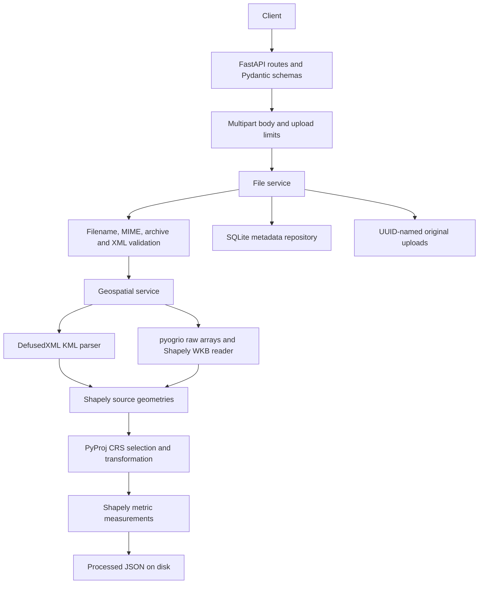

# Geospatial File Measurement API

## Overview

A FastAPI backend that accepts KML files and ZIP archives containing a Shapefile,
extracts their features, and returns original geometry, attributes, source CRS, and
metric measurements. The implementation separates upload validation, format parsing,
projection selection, measurement, and persistence so each can be reviewed and tested
independently.

The service processes uploads synchronously, saves successful results, and serves
subsequent metadata and measurement requests without parsing the source again.

## Features

- Standard KML 2.2 placemarks, including nested folders and ExtendedData attributes.
- ZIP Shapefiles, including nested directories and case-insensitive component names.
- Feature indexes, source feature IDs, attributes, and GeoJSON-shaped geometry.
- Polygon/MultiPolygon area and LineString/MultiLineString length.
- CRS-aware measurement with automatic UTM selection and polar UPS fallback.
- Explicit metres and square metres; original coordinates are preserved.
- Per-feature errors for invalid, empty, unsupported, or unsafe-to-measure geometry.
- Upload, archive, XML, feature count, and coordinate count validation.
- SQLite metadata and persistent source/result files.
- Swagger, ReDoc, automated tests, sample generation, and live HTTP smoke checks.
- Docker with a non-root process, healthcheck, and persistent Compose volume.

## Architecture



The application factory accepts explicit settings for isolated tests. Parsing and
measurement run in a worker thread so geospatial processing does not run on the
ASGI event loop. SQLite connections are short-lived and never shared across threads.

## Project Structure

```text
app/
  main.py                      Application factory, lifespan, health, error handlers
  api/routes/files.py          Upload, metadata, and measurements endpoints
  core/                       Settings, logging, exceptions, request body limit
  models/file.py              Internal dataset and feature dataclasses
  schemas/file.py             Typed API contracts and OpenAPI examples
  services/
    archive_service.py        Safe ZIP validation and extraction
    kml_service.py            Secure KML parsing
    geospatial_service.py     Shapefile reading and dataset validation
    crs_service.py            Projection selection and dateline detection
    measurement_service.py    Feature serialization and metric measurements
    file_service.py           Processing orchestration and artifact persistence
  repositories/              SQLite metadata storage
tests/                       Generated fixtures, API and numerical correctness tests
examples/survey.kml           Small human-readable upload example
scripts/                     Shapefile sample generation and live HTTP smoke test
data/uploads/                Runtime original files (ignored by Git)
data/processed/              Runtime results (ignored by Git)
Dockerfile
docker-compose.yml
requirements.txt             Pinned runtime dependencies
requirements-dev.txt         Test and lint tools
pyproject.toml               Package, pytest, and Ruff configuration
.env.example
LICENSE                      MIT
```

## Setup

Use Python 3.12 or newer and run commands from the repository root. The geospatial
packages use prebuilt wheels; supported Windows and Linux installations do not need
a separate GDAL installation. Docker provides the tested Python 3.12 Linux stack.

```bash
python -m venv .venv
```

Windows PowerShell activation:

```powershell
.\.venv\Scripts\Activate.ps1
```

Windows Command Prompt activation:

```bat
.venv\Scripts\activate.bat
```

Linux/macOS activation:

```bash
source .venv/bin/activate
```

Install and run:

```bash
python -m pip install -r requirements.txt
python -m uvicorn app.main:app --reload
```

The defaults work without an `.env` file. To customize them, copy `.env.example` to
`.env` (`Copy-Item .env.example .env` in PowerShell, `cp .env.example .env` on Unix).
Environment variables override `.env`. Relative paths are relative to the working
directory. No machine-specific paths or secrets are required.

| Variable | Default | Purpose |
| --- | --- | --- |
| `APP_ENV` | `development` | Deployment environment label |
| `API_PORT` | `8000` | Compose host port (Uvicorn CLI uses `--port` instead) |
| `LOG_LEVEL` | `INFO` | Application log level |
| `UPLOAD_DIR` | `./data/uploads` | Original upload storage |
| `PROCESSED_DIR` | `./data/processed` | Processed result storage |
| `DATABASE_URL` | `sqlite:///./data/app.db` | File-backed SQLite database |
| `MAX_UPLOAD_SIZE_MB` | `50` | Maximum uploaded file bytes, in MiB |
| `MAX_ARCHIVE_SIZE_MB` | `200` | Maximum total declared ZIP expansion, in MiB |
| `MAX_ARCHIVE_MEMBERS` | `256` | Maximum ZIP entry count |
| `MAX_COMPRESSION_RATIO` | `100` | Maximum per-entry uncompressed/compressed ratio |
| `MAX_FEATURES` | `10000` | Maximum accepted feature count |
| `MAX_COORDINATES` | `1000000` | Maximum accepted coordinate count |

The multipart request limit is the upload limit plus 1 MiB of envelope overhead.
The file limit also applies while copying the uploaded file. Only file-backed
`sqlite:///...` database URLs are supported.

## Docker

```bash
docker compose up --build
```

For a detached run:

```bash
docker compose up --build -d
docker compose ps
docker compose logs api
docker compose down
```

The API is available at `http://localhost:8000`. The named `geospatial-data` volume
persists metadata, original uploads, and results across container restarts. The
image runs as UID 10001; its data directory is writable by that user. Binary
GeoPandas/Shapely/PyProj/pyogrio wheels supply the geospatial native libraries.

If port 8000 is already occupied, set `API_PORT=18000` in `.env` for Compose, or
run `python -m uvicorn app.main:app --reload --port 18000` locally. Use that port
in the documentation URLs and smoke test's `--base-url` argument.

`docker compose down` preserves the data volume. Use Docker volume deletion only
when deliberately discarding the service's stored data.

Compose forwards `LOG_LEVEL` and every `MAX_*` limit listed above using shell
environment values or `.env`, with the same defaults as the application. It fixes
`APP_ENV=production` and storage paths under `/app/data` so the named volume
persists them; host `UPLOAD_DIR`, `PROCESSED_DIR`, and `DATABASE_URL` do not change
those container paths. Local execution uses the configured paths directly.

For a build that reinstalls dependencies without cached build steps:

```bash
docker compose build --no-cache
docker compose up -d --wait
```

## API

| Method | Endpoint | Result |
| --- | --- | --- |
| `POST` | `/api/files/` | Process a multipart `file` upload; `201 Created` |
| `GET` | `/api/files/{id}/` | Uploaded file metadata; `200 OK` |
| `GET` | `/api/files/{id}/measurements/` | Every feature and its measurement/error; `200 OK` |
| `GET` | `/health` | Liveness response `{"status":"ok"}` |
| `GET` | `/` | API name, version, and documentation path |

Swagger: <http://localhost:8000/docs> · ReDoc: <http://localhost:8000/redoc> ·
OpenAPI: <http://localhost:8000/openapi.json>

Upload the included KML (use `curl.exe` in Windows PowerShell):

```bash
curl -X POST "http://localhost:8000/api/files/" -F "file=@examples/survey.kml"
```

Generate and upload a Shapefile ZIP:

```bash
python scripts/generate_samples.py
curl -X POST "http://localhost:8000/api/files/" -F "file=@data/sample-shapefile.zip"
```

Use the returned UUID for retrieval:

```bash
curl "http://localhost:8000/api/files/<id>/"
curl "http://localhost:8000/api/files/<id>/measurements/"
curl "http://localhost:8000/health"
```

Successful uploads include a `Location` header for the metadata resource. MIME
types are checked for practical consistency, but content parsing determines whether
the file is valid. Common generic upload MIME types are accepted.

## Example Responses

An upload of the generated UTM Shapefile returns metadata like:

```json
{
  "id": "b2b9cbbc-92ca-4a83-9f00-1733ce7b31d4",
  "filename": "sample-shapefile.zip",
  "file_type": "zip",
  "feature_count": 1,
  "crs": "EPSG:32644",
  "status": "COMPLETED",
  "geometry_types": ["Polygon"],
  "created_at": "2026-01-01T12:00:00Z",
  "processing_time_ms": 25.4
}
```

The corresponding measurement is exactly 10,000 square metres, within floating
point tolerance:

```json
{
  "file_id": "b2b9cbbc-92ca-4a83-9f00-1733ce7b31d4",
  "crs": "EPSG:32644",
  "measurement_crs": "EPSG:32644",
  "features": [{
    "feature_id": 0,
    "source_feature_id": "0",
    "layer": "Shapefile",
    "geometry_type": "Polygon",
    "geometry": {
      "type": "Polygon",
      "coordinates": [[[500000,1500000],[500000,1500100],[500100,1500100],[500100,1500000],[500000,1500000]]]
    },
    "properties": {"name": "Parcel A"},
    "measurement": {"type": "area", "value": 10000.0, "unit": "square_meters"},
    "measurement_error": null
  }]
}
```

`feature_id` is a stable zero-based index in the processed dataset;
`source_feature_id` preserves a KML placemark ID or Shapefile record ID when available.
`crs` always describes the original geometry. Geometry has the GeoJSON structure,
but projected coordinates are **not RFC 7946 WGS84 GeoJSON**. Consumers must use the
reported CRS. Empty geometry is serialized as `null` with its geometry type preserved.
DBF missing/nonfinite attribute values become JSON `null`; dates use ISO strings.
Shapefile geometry and DBF attributes are read into separate arrays before feature
construction. A DBF field named `geometry` remains in `properties.geometry`, while
the feature's top-level `geometry` contains its actual spatial representation.

| Geometry | Measurement behavior |
| --- | --- |
| Polygon / MultiPolygon | Area in `square_meters`, holes subtracted |
| LineString / MultiLineString | Total length in `meters` |
| Point / MultiPoint | `measurement: null`, no error |
| GeometryCollection | Preserved, `measurement: null`, explanatory error |
| Empty / null geometry | `geometry: null`, explanatory error |
| Topologically invalid geometry | Preserved, explanatory error; never silently repaired |

Measurements are planar 2D calculations. Altitude is preserved where present but
does not contribute to area or length. A nested homogeneous KML MultiGeometry becomes the
corresponding MultiPolygon, MultiLineString, or MultiPoint; mixed parts become a
GeometryCollection. Empty parts are retained and prevent homogeneous aggregation.
KML `name`, `description`, and `address` retain their standard metadata keys.
Custom fields retain their existing flat aliases when those keys do not collide.
Every named `Data/value` and `SchemaData/SimpleData` entry is also preserved in the
ordered `properties.extended_data` list, including duplicates, schema URLs and
display names. The first custom value supplies a flat alias; later duplicate
values remain in the list. The reserved custom name `extended_data` is preserved
only inside that list. Custom values never overwrite standard metadata.

For example, a placemark named `Feature title` with custom data named `name`:

```json
{
  "properties": {
    "name": "Feature title",
    "extended_data": [
      {"kind": "Data", "name": "name", "value": "Business name", "display_name": null}
    ]
  }
}
```

Recognizable geometry in an incorrect XML namespace and unsupported XML encodings
return HTTP 400. The parser supports the documented KML subset, not arbitrary XML
extensions embedded in ExtendedData.

## CRS Handling

Longitude/latitude degrees are angular units. Shapely area or length on EPSG:4326
coordinates therefore cannot be labeled square metres or metres. The CRS service
selects a projected CRS and PyProj transforms the geometry before Shapely measures it.

1. Read a Shapefile CRS from its `.prj`. Missing components are rejected; an
   unreadable CRS produces `422`. KML 2.2 coordinates follow WGS84 longitude,
   latitude, optional altitude, so their source CRS is EPSG:4326.
2. Retain a supplied projected CRS if both horizontal axes use metres, except
   EPSG:3857 and EPSG:3395 Mercator projections, whose scale distortion makes them
   poor general measurement defaults.
3. Geographic axes are validated using their angular-unit conversion factors
   before transformation, so degrees and grads/gons are handled correctly and
   out-of-range source coordinates cannot be silently wrapped by PROJ. Normalize
   into WGS84 for longitude/latitude checks and projection selection.
   For geographic, non-metric, and those Mercator inputs, transform valid source
   coordinates to WGS84 and locate the midpoint of the dataset's smallest circular
   longitude extent and latitude extent. This handles nearby disconnected features
   on opposite sides of the antimeridian without selecting a location near Greenwich.
4. Compute `floor((longitude + 180) / 6) + 1`, clamped to zones 1–60. Northern
   zones use EPSG:326xx and southern zones EPSG:327xx. Norway and Svalbard zone
   exceptions are included. Above 84°N or below 80°S, use EPSG:32661/32761 (UPS).
5. Use `always_xy=True` to preserve longitude/easting first. Transform with error
   checking, then calculate in projected metres. Report `measurement_crs` once for
   the dataset, alongside source `crs`.

The automatic local projection policy limits geographic extent to 6° longitude
and 8° latitude. Broader datasets remain inspectable, but measurable features get
an error and no value; `measurement_crs` is null. Split such inputs into regional
datasets. For projected inputs requiring reprojection, selection additionally
samples a bounded 33-by-33 grid over the complete source-coordinate envelope,
including its interior. A transformed envelope exceeding the same local limits
or showing longitude jumps is rejected. This prevents distant endpoints of a
world-spanning Web Mercator segment from masquerading as a short dateline segment.
This envelope policy is deliberately conservative: it can reject disconnected or
irregular datasets whose enclosing rectangle is unsafe even if individual parts
could be measured separately. Split such datasets before upload.

Dateline-crossing polygon rings or line segments also receive explicit
per-feature errors after normalization to WGS84, including projected sources
requiring reprojection. Unsafe selection returns `measurement: null` and a useful
`measurement_error`, while retaining original geometry and properties. Empty geographic
datasets have no selected projection. Point-only datasets can still report the
projection selected from their locations.

UTM/UPS measurements include projection scale distortion and are not geodesic
measurements. A supplied metre-based projected CRS is trusted as the author's
choice; the service does not certify its area of use or accuracy for that dataset.
Finite envelope sampling is a conservative screening policy, not a mathematical
guarantee for every possible custom projection. Measurements transform existing
vertices and remain planar approximations; curved/geodesic path preservation,
global measurements and specialized projection-boundary handling are outside scope.

Implementation references: [PyProj transformer documentation](https://pyproj4.github.io/pyproj/stable/api/transformer.html)
and [pyogrio vector I/O API](https://pyogrio.readthedocs.io/en/latest/api.html).

## Error Handling

| Status | Meaning |
| --- | --- |
| `400` | Unsupported extension/MIME, empty/corrupt input, malformed KML, unsafe ZIP, missing components, resource limits |
| `413` | Uploaded file or multipart body exceeds the size limit |
| `422` | Invalid UUID, missing multipart field, or missing/unreadable source CRS |
| `404` | Requested file UUID is unknown |
| `500` | Unexpected processing/storage failure or missing/corrupt stored result |

Application errors have a useful `{"detail":"..."}` response. FastAPI request
validation errors use its standard structured `detail` array. Internal exceptions
are logged server-side and return a generic message without paths or tracebacks.
After parsing, null, empty, invalid and unsupported geometries receive
`measurement_error`; these do not fail other features or the upload. Structural
parsing failures, such as malformed coordinate tuples or rings, reject the file
with HTTP 400. Dataset-wide projection-selection failures suppress measurements
for its measurable features. `COMPLETED` means processing finished, including any
explicitly reported feature measurement errors.

## Testing

Install development tools:

```bash
python -m pip install -r requirements-dev.txt
python -m pytest
python -m pytest -v
python -m pytest --cov=app --cov-report=term-missing
python -m ruff check .
python -m ruff format --check .
```

The suite checks the health and documentation endpoints, both upload formats,
response models, metadata retrieval, persistence across application restarts,
concurrent uploads, known projected areas/lengths, polygon holes, multipart
geometries, geographic transformations, independent geodesic reference values,
southern UTM and polar selection, non-metric CRS conversion, dateline/wide-extent
behavior, malformed/empty/invalid data, XML entity protection, ZIP traversal,
symlinks, duplicate entries, component requirements, expansion/ratio limits,
upload/body limits, and storage failure cleanup. Fixtures are generated in isolated
temporary directories; no binary test data is required.

Actual submission results and tested platform versions are recorded in
[VALIDATION.md](VALIDATION.md).

Start a real Uvicorn subprocess, exercise every required endpoint for KML and ZIP,
and automatically clean up its temporary database and uploads:

```bash
python scripts/smoke_test.py
```

Check an already running local or Docker server:

```bash
python scripts/smoke_test.py --base-url http://127.0.0.1:8000
```

The latter creates two persistent example uploads on that server.

Add `--regressions` to either smoke command to exercise all audit regressions over
real HTTP, including actual Shapefile attribute collisions, unsafe extents, grads,
KML metadata collisions, nested geometries and parser errors. This requires the
development dependencies and tests directory. Against an existing server it adds
further persistent test uploads; use a disposable server/volume for validation.

```bash
python scripts/smoke_test.py --regressions
python scripts/smoke_test.py --base-url http://127.0.0.1:8000 --regressions
```

## Design Decisions

- **FastAPI and Pydantic:** typed response contracts, generated API documentation,
  multipart uploads, and straightforward dependency injection without a large framework.
- **pyogrio raw arrays and Shapely WKB:** use GDAL's real Shapefile parser and keep
  attributes separate from geometry before feature construction. This prevents
  geometry-column name collisions. GeoPandas remains useful for fixture generation.
  The input driver is checked before loading the feature data.
- **DefusedXML for KML:** KML driver availability varies between GDAL builds. A
  bounded, secure KML parser gives the same behavior on Windows and Linux without
  changing Fiona's global driver registry or depending on LIBKML. No KML GDAL
  configuration is needed. It supports the documented KML subset and rejects
  network links, models, and gx tracks rather than fetching or silently losing them.
- **Shapely and PyProj:** geometry validation/serialization and metric calculations
  are separated from CRS selection and coordinate transformation.
- **SQLite:** enough for indexed UUID metadata retrieval. Parameterized SQL and
  short-lived connections provide simple persistence without an unnecessary ORM.
- **Synchronous processing:** predictable assignment behavior; uploads return only
  after processing. Worker threads allow the event loop to keep serving requests.
- **Cached results on disk:** no repeated geospatial file reads on GET requests;
  large geometry JSON is kept out of the metadata database.
- **Local projection strategy:** deterministic, testable UTM selection with explicit
  extent limits is preferable to labeling arbitrary geographic calculations as metric.

Only completed uploads are committed to SQLite. Invalid uploads leave no metadata
row or source/result artifact. Originals and results are named by generated UUIDs.
Each result is written privately and renamed atomically; metadata is inserted only
after both artifacts exist. Ordinary failures trigger compensating cleanup.
There is no persisted asynchronous job lifecycle because no background jobs exist.
Keep the database, originals, and results together when backing up or restoring.

## Alternatives Considered

Django REST Framework would add application machinery that these three resource
endpoints do not need. PostGIS and a spatial index become useful for querying across
datasets, but this service returns stored per-file results. An ORM adds little to a
single metadata table. A background queue would add worker, broker, retry, and job
status requirements; it is a reasonable next step for large uploads. Keeping entire
geometries in SQLite would inflate metadata storage without enabling spatial queries.

## Security

- Sanitized display filenames; generated UUID paths determine all storage locations.
- Extension and compatible MIME checks followed by real format parsing.
- Multipart body bounds, upload byte bounds, feature and coordinate limits.
- ZIP entry count, total expansion, and per-entry compression ratio limits.
- All ZIP entry paths inspected, including extra files; absolute paths, traversal,
  Windows drive/stream paths, control characters, symlinks, and encryption rejected.
- Exactly one Shapefile with matching nonempty `.shp`, `.shx`, `.dbf`, `.prj` files;
  optional `.cpg` retained. Only these components are extracted under fixed names
  inside a temporary directory. Other files are never executed or parsed.
- XML DTDs/entities disabled and external KML links rejected. No network fetching.
- Temporary extraction directories and failed artifacts cleaned up.
- No client-visible filesystem paths or internal stack traces.
- Non-root Docker process; runtime data, `.env`, caches, and virtual environments
  excluded from version control and Docker's build context.

This assignment service has no authentication, request rate limits, or retention
policy. Add those controls and a reverse proxy request limit before public deployment.

## Limitations

- Entire accepted datasets and result responses are held in memory during processing;
  feature/coordinate limits are admission controls, not process memory isolation.
- Large datasets are processed synchronously; GET measurements has no pagination.
- UTM/UPS is appropriate for local data, with the documented distortion and extent
  limits. Complex dateline-crossing lines/polygons need specialized handling.
- Supplied metre-based projections are trusted; no automatic CRS guessing for Shapefiles.
- KML 2.2 standard geometry is supported. Styles, overlays, models, tracks, linked
  resources, KMZ, and standalone LinearRing geometries are outside the accepted subset.
- GeometryCollection measurement is intentionally unspecified rather than summing
  unlike dimensions. Invalid topology is reported rather than automatically repaired.
- SQLite and local disk suit a single deployment with a shared persistent volume.
  Abrupt process/power loss between artifact writes and the DB commit can leave
  orphan artifacts; ordinary exceptions are cleaned up. No startup reconciliation
  or distributed transaction is implemented.
- New named volumes inherit image permissions; an existing host-mounted directory
  needs its own UID 10001 write permissions.

## Future Scope

Background processing and job status endpoints; object storage and retention;
PostGIS for cross-dataset spatial queries; authentication and rate limiting;
paginated or streaming feature responses; geodesic/equal-area measurement options;
specialized dateline support and richer KML geometry; crash recovery/reconciliation;
distributed workers, cloud deployment, metrics, traces, and operational dashboards.

## Learning

The core lesson is that numeric geometry operations have no implicit physical unit:
the CRS and projection scale determine what a result means. Tests that inverse-project
a known UTM square expose degree-based calculations immediately, while a separate
geodesic comparison checks that the projection's scale remains reasonable. KML also
illustrates why format support must be tested on the deployed stack rather than
inferred from a library name. Archive validation needs to cover extra entries as well
as the selected Shapefile, and metadata should become visible only after its cached
result exists.

## GitHub Submission

Review `README.md`, `app/services/crs_service.py`, `app/services/measurement_service.py`,
`app/services/archive_service.py`, `app/services/kml_service.py`,
`app/services/file_service.py`, `app/api/routes/files.py`, `app/schemas/file.py`,
the `tests/` directory, `requirements*.txt`, `.env.example`, `.gitignore`, `Dockerfile`,
`docker-compose.yml`, and `LICENSE`.

The optional GitHub CLI commands below require an installed `gh` executable.

Initialize and commit locally:

```bash
git init
git branch -M main
git add .
git status --short
git diff --cached --stat
git commit -m "Build CRS-aware geospatial file measurement API"
```

Inspect staged files before committing; `.env`, virtual environments, caches,
databases, uploads, and processed results must not be included.

When ready, publish with GitHub CLI (these commands are instructions only):

```bash
gh auth login
gh repo create geospatial-file-measurement-api --public --source=. --remote=origin
git push -u origin main
```

For an existing empty GitHub repository:

```bash
git remote add origin https://github.com/YOUR_USERNAME/geospatial-file-measurement-api.git
git push -u origin main
```

No repository is created on GitHub or pushed by the implementation process.
